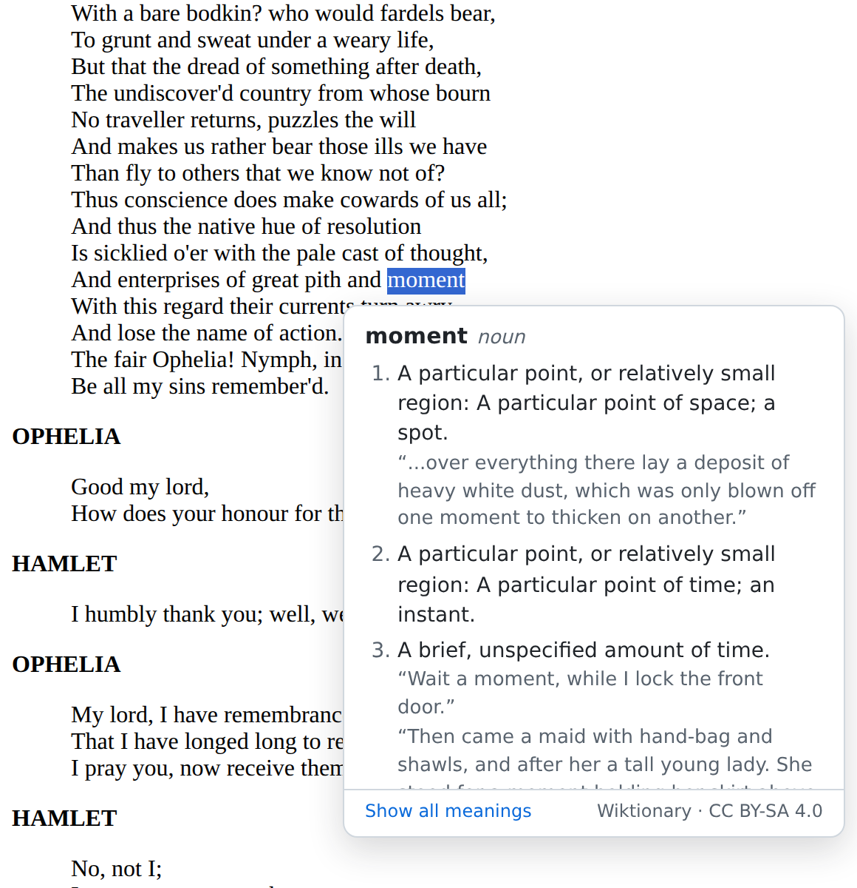
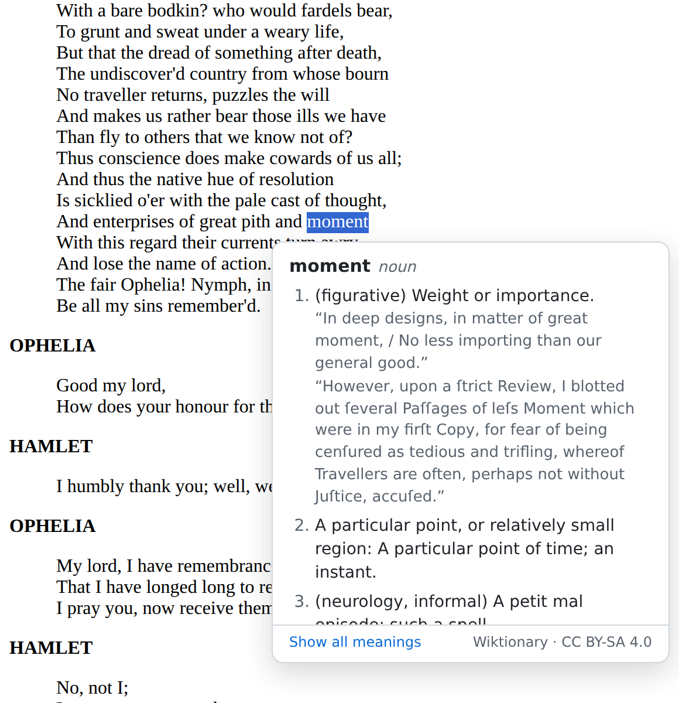

# Contextual Dictionary

A Chrome extension that defines the word you select on any web page, from a copy of the English Wiktionary kept on your computer, and lists the meaning that fits the sentence first, using a small word-sense model that also runs on your computer.

- **Dictionary:** English Wiktionary (Kaikki.org extract of 2026-10-30): about 1.2 million headwords and a million meanings, with examples.
- **Order by context** (on by default once the model is downloaded): the model Ettin-150m-WSD (INT8 ONNX, run with ONNX Runtime on WebAssembly) lists the meanings inside each entry by how well they fit the passage. No meaning is dropped and no score is shown.
- **Privacy:** what you select never leaves your computer. The only network use is the one-time download of the dictionary and the model, each of which you confirm. See [docs/privacy.md](docs/privacy.md).

Site: https://andrepaim.github.io/contextual-dictionary/

## Example

"And enterprises of great pith and moment" (*Hamlet*, act 3, scene 1, read on [shakespeare.mit.edu](https://shakespeare.mit.edu/hamlet/hamlet.3.1.html)). Wiktionary lists the meanings of "moment" starting with a point in space and a point in time. With "Order by context" the card opens on "Weight or importance", which is what Hamlet means.

| Dictionary order | Order by context |
| --- | --- |
|  |  |

Both are screenshots of version 0.1.0 on that page, with the switch off and on.

## Install

Not in the Chrome Web Store yet. Install the release ZIP as an unpacked extension (Chrome 124 or later):

1. Download `contextual-dictionary-<version>.zip` from [Releases](https://github.com/andrepaim/contextual-dictionary/releases) (`SHA256SUMS.txt` is next to it) and unzip it into a folder you will keep.
2. Open `chrome://extensions`, switch on **Developer mode**, click **Load unpacked** and choose the folder.
3. Open the extension's window from the toolbar and confirm the downloads it offers:
   - **Dictionary:** 66.5 MB, needed for definitions.
   - **Context model:** 147 MB to download, 271 MB on disk, needed for "Order by context".

Both come from this repository's release [`assets-v1`](https://github.com/andrepaim/contextual-dictionary/releases/tag/assets-v1) and are checked against pinned SHA-256 digests ([docs/assets.md](docs/assets.md)). After that the extension works offline.

## Use

Double-click a word, or select up to four words, on an ordinary web page. A card opens beside it with up to three entries, three meanings per entry and one example per meaning. **Show all meanings** reveals the remaining entries, meanings and examples. Escape or a click elsewhere closes it; the link at the bottom opens the word on Wiktionary. The extension's window has four switches: **Show definitions**, **Order by context**, **Show order details** and **On <this site>**, and a **Remove** button for each download. With **Show order details** on (it is off by default), the card also says what the model did: "was 3rd" beside each meaning it moved, and a line such as "Ordered by context" or "Dictionary order · model still loading". More in [docs/user-guide.md](docs/user-guide.md).

## What to expect

Measured on a desktop with a 24-thread Intel CPU ([docs/validation.md](docs/validation.md)): a definition appears in about 10 ms, and the first one after the browser starts in 0.1–0.3 s. With "Order by context", half the cards appear within 0.3 s and none waits longer than 0.75 s (words with many meanings take 0.4–0.6 s); with a quarter of the threads, as on a smaller machine, about two thirds are ordered in time and the rest show the dictionary's order first. On 2,300 examples whose meaning Wiktionary's editors marked, the model's order put the right meaning first 55% of the time, against 28% for the dictionary's own order, and within the three shown 78% against 60%.

**Limits**

- English only, for definitions and passages; a passage that does not look English keeps dictionary order.
- It cannot run on Chrome's own pages, the Chrome Web Store or Chrome's PDF viewer, or inside text fields. A double-click on a link follows the link, as in any browser.
- Entries keep their dictionary order: when a word has several entries (the financial "bank" and the river "bank"), the right meaning can be in a later entry.
- Words with very many meanings ("run", "set", "draw" have over 100) are ordered only among the first ones offered to the model (prompts are limited to 1,600 characters); for entries with 17 or more meanings the model gets the right one first less than a third of the time.
- While the model is loaded (from the first lookup with "Order by context" on until ten idle minutes have passed), the extension uses about 1 GB of memory more; it is released when the model unloads.
- The model was trained on WordNet definitions, not Wiktionary's, and up to 120 characters on each side of the selection is all it sees.

## Develop

```bash
npm ci
npm run check        # secret scan, typecheck, unit tests with coverage, build, build check
npx playwright install chromium
npm run test:e2e     # end-to-end tests with the built extension (builds dist/ and dist-e2e/)
npm run package      # package/contextual-dictionary-<version>.zip and SHA256SUMS.txt
```

Load `dist/` as an unpacked extension from `chrome://extensions` (Developer mode). The plan and the architecture are in [docs/plan.md](docs/plan.md), the developer rules in [CLAUDE.md](CLAUDE.md), and the measurements behind the defaults, with how to run them again, in [docs/validation.md](docs/validation.md) and `validation/`.

### Shared dictionary core

The extension installs `@andrepaim/contextual-dictionary-core` from the checked-in npm tarball. To use the same package from another project, replace `COMMIT_SHA` with a full commit SHA that contains the artifact. The package includes dictionary lookup, contextual ordering and shared definition card assets. [Core API](packages/core/README.md)

```sh
npm install --ignore-scripts 'https://raw.githubusercontent.com/andrepaim/contextual-dictionary/COMMIT_SHA/artifacts/contextual-dictionary-core-0.2.1.tgz'
```

After changing core source, bump the core version in `packages/core/package.json` and run `npm run core:pack`. Update the extension's file dependency to the new tarball and refresh the lockfile with `npm install --ignore-scripts`. Commit the source, tarball and lockfile together. `npm run core:check` rebuilds the tarball, installs it in an isolated Node project, exercises the engine and card exports, and bundles the card stylesheet as text.

## Site

`site/` and `docs/privacy.md` are published at https://andrepaim.github.io/contextual-dictionary/ by `.github/workflows/pages.yml` on every push to `main` that changes them. `npm run build:site` builds it into `_site/`.

## Release

Pushing a tag `v<version>` (equal to `version` in `package.json`) runs `.github/workflows/release.yml`: every check, then the reproducible ZIP built twice, then a GitHub release with the ZIP and `SHA256SUMS.txt`. Run the workflow by hand for a dry run that stops before publishing.

## Licences

Code: MIT ([LICENSE](LICENSE)). The dictionary pack is CC BY-SA 4.0 (Wiktionary contributors, via Kaikki.org); the model is Apache-2.0 (its base model MIT); ONNX Runtime is MIT. Details in [NOTICE.md](NOTICE.md).
