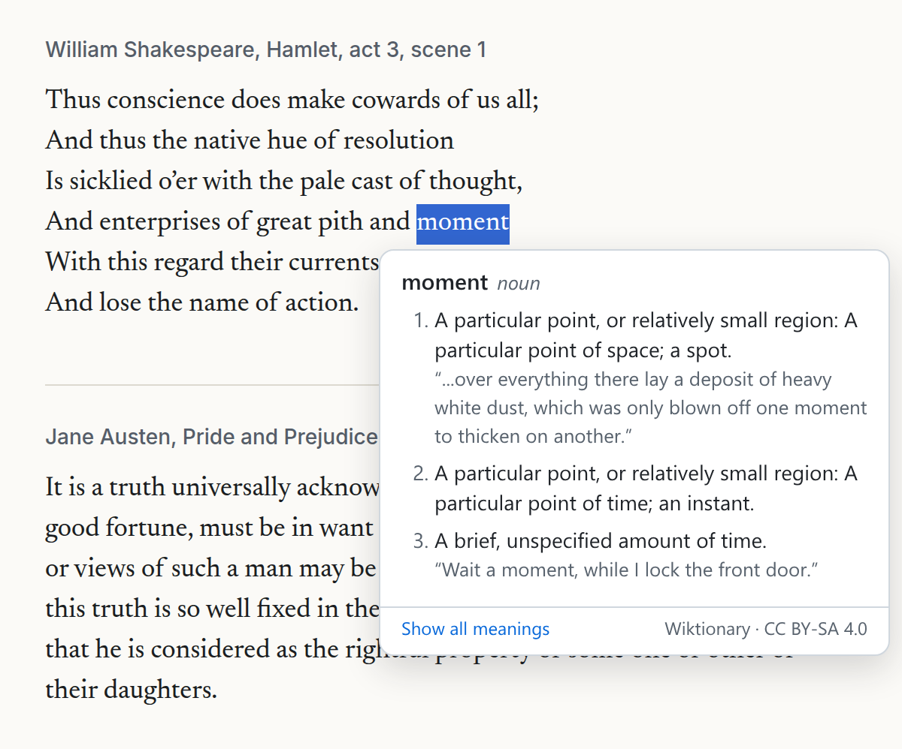
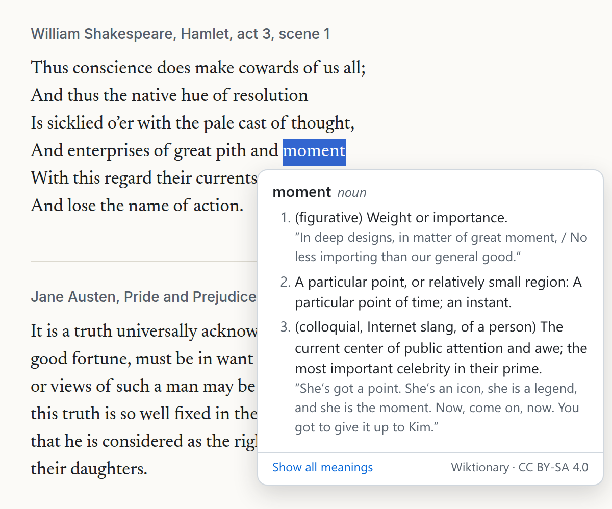

<div align="center">
  
  <h1>Contextual Dictionary</h1>
  <p><strong>What does this word mean here?</strong></p>
  <p>Select a word on any web page to see its English Wiktionary meanings, with the one that fits the sentence first, without the text leaving your computer.</p>
  <p>
    <a href="https://github.com/andrepaim/contextual-dictionary/actions/workflows/ci.yml"></a>
    <a href="https://chromewebstore.google.com/detail/contextual-dictionary/jdjkhefpmejijkjdknchpnghijibnali"></a>
    
  </p>
  <p><a href="https://chromewebstore.google.com/detail/contextual-dictionary/jdjkhefpmejijkjdknchpnghijibnali"><strong>Add to Chrome</strong></a> · <a href="https://andrepaim.github.io/contextual-dictionary/">Site</a> · <a href="docs/user-guide.md">User guide</a> · <a href="docs/privacy.md">Privacy</a></p>
</div>

https://github.com/user-attachments/assets/ee1b35a2-eaa6-4413-a128-ab0d616fbfcb

Three lookups on the site's [practice page](https://andrepaim.github.io/contextual-dictionary/try.html), recorded in Chromium with version 0.4.0 (37 seconds, no sound).

Contextual Dictionary is a Chrome extension. Double-click a word and a card shows its meanings from a copy of the English Wiktionary kept on your computer, with the meaning that fits the sentence first, chosen by a small word-sense model that also runs on your computer.

- **Dictionary:** English Wiktionary (Kaikki.org extract of 2026-10-30): about 1.2 million headwords and a million meanings, with examples.
- **Order by context** (on by default once the model is downloaded): a word-sense model fine-tuned from Ettin-150m-WSD on English Wiktionary examples (INT8 ONNX, run with ONNX Runtime on WebAssembly) lists the meanings inside each entry by how well they fit the passage. No meaning is dropped and no score is shown.
- **Privacy:** what you select never leaves your computer. The only network use is the one-time download of the dictionary and the model, each of which you confirm. See [docs/privacy.md](docs/privacy.md).

## Example

"And enterprises of great pith and moment" (*Hamlet*, act 3, scene 1). Wiktionary lists the meanings of "moment" starting with a point in space and a point in time. With "Order by context" the card opens on "Weight or importance", Wiktionary's fourth meaning, which is what Hamlet means.

| Dictionary order | Order by context |
| --- | --- |
|  |  |

Both are captures of version 0.4.0 on the practice page, with "Order by context" off and on.

## Install

1. Add it to Chrome (124 or later) from the [Chrome Web Store](https://chromewebstore.google.com/detail/contextual-dictionary/jdjkhefpmejijkjdknchpnghijibnali).
2. Open the extension's window from the toolbar and confirm the downloads it offers:
   - **Dictionary:** 66.5 MB, needed for definitions.
   - **Context model:** 189 MB to download, 207 MB on disk, needed for "Order by context".

Both come from this repository's release [`assets-v2`](https://github.com/andrepaim/contextual-dictionary/releases/tag/assets-v2) and are checked against pinned SHA-256 digests ([docs/assets.md](docs/assets.md)). After that the extension works offline.

Without the store: download `contextual-dictionary-<version>.zip` from [Releases](https://github.com/andrepaim/contextual-dictionary/releases) (`SHA256SUMS.txt` is next to it), unzip it into a folder you will keep, then open `chrome://extensions`, switch on **Developer mode**, click **Load unpacked** and choose the folder. Chrome does not update that copy, and it keeps its own downloads and settings, apart from the store's.

## Use

Double-click a word, or select up to four words, on an ordinary web page. A card opens beside it with up to three entries, three meanings per entry and one example per meaning. **Show all meanings** reveals the rest; Escape or a click elsewhere closes the card, and the link at the bottom opens the word on Wiktionary.

The extension's window has four switches, **Show definitions**, **Order by context**, **Show order details** and **On &lt;this site&gt;**, and a **Remove** button for each download. With **Show order details** on (it is off by default), the card also says what the model did: "was 3rd" beside each meaning it moved, and a line such as "Ordered by context" or "Dictionary order · model still loading". More in [docs/user-guide.md](docs/user-guide.md).

## What to expect

Measured on a desktop with a 24-thread Intel CPU ([docs/validation.md](docs/validation.md)):

- **Definitions** appear in about 8 ms, and the first one after the browser starts in 0.1–0.3 s.
- **Order by context:** half the cards appear within 0.3 s and none waits longer than 0.75 s; words with many meanings take 0.4–0.6 s.
- **On a smaller machine** (a quarter of the threads), about 70% of lookups are ordered in time; the rest show the dictionary's order first.
- **Accuracy:** on 2,300 examples whose meaning Wiktionary's editors marked, the model's order put the right meaning first 64% of the time, against 28% for the dictionary's own order, and within the three shown 81% against 60%.

## Limits

- English only, for definitions and passages; a passage that does not look English keeps dictionary order.
- It cannot run on Chrome's own pages, the Chrome Web Store or Chrome's PDF viewer, or inside text fields. A double-click on a link follows the link, as in any browser.
- Entries keep their dictionary order: when a word has several entries (the financial "bank" and the river "bank"), the right meaning can be in a later entry.
- Words with very many meanings ("draw", "run" and "break" have over 100) are ordered only among the first ones offered to the model (prompts are limited to 1,600 characters); for entries with 17 or more meanings the model gets the right one first about a third of the time.
- While the model is loaded (from the first lookup with "Order by context" on until ten idle minutes have passed), the extension uses about 1 GB of memory more; it is released when the model unloads.
- The model sees only the selection and up to 120 characters on each side of it. It was fine-tuned on English Wiktionary's own examples ([docs/validation.md](docs/validation.md), "Training round 1").

## Develop

```bash
npm ci
npm run check        # secret scan, core package check, typecheck, unit tests with coverage, build, build check
npx playwright install chromium
npm run test:e2e     # end-to-end tests with the built extension (builds dist/ and dist-e2e/)
npm run package      # package/contextual-dictionary-<version>.zip and SHA256SUMS.txt
```

Load `dist/` as an unpacked extension from `chrome://extensions` (Developer mode). The shared core package, the site and its captures, releases and measurements are in [docs/development.md](docs/development.md); the plan and the architecture in [docs/plan.md](docs/plan.md); the rules for changes in [CLAUDE.md](CLAUDE.md). [docs/README.md](docs/README.md) lists every document.

## Licences

Code: MIT ([LICENSE](LICENSE)). The dictionary pack is CC BY-SA 4.0 (Wiktionary contributors, via Kaikki.org); the model is Apache-2.0, fine-tuned from Ettin-150m-WSD (Apache-2.0, its base model MIT) on English Wiktionary and Wikipedia text (CC BY-SA, published as the dataset [andrepaim/wiktionary-wsd](https://huggingface.co/datasets/andrepaim/wiktionary-wsd/tree/84b6444e83219aaa76c29a517a64a640c1df9a46)), and its float weights are on Hugging Face as [andrepaim/Ettin-150m-WSD-wiktionary](https://huggingface.co/andrepaim/Ettin-150m-WSD-wiktionary/tree/0edcbab04bb30eadeeef6babb26e8055b173b8d7); ONNX Runtime is MIT. Details in [NOTICE.md](NOTICE.md).
